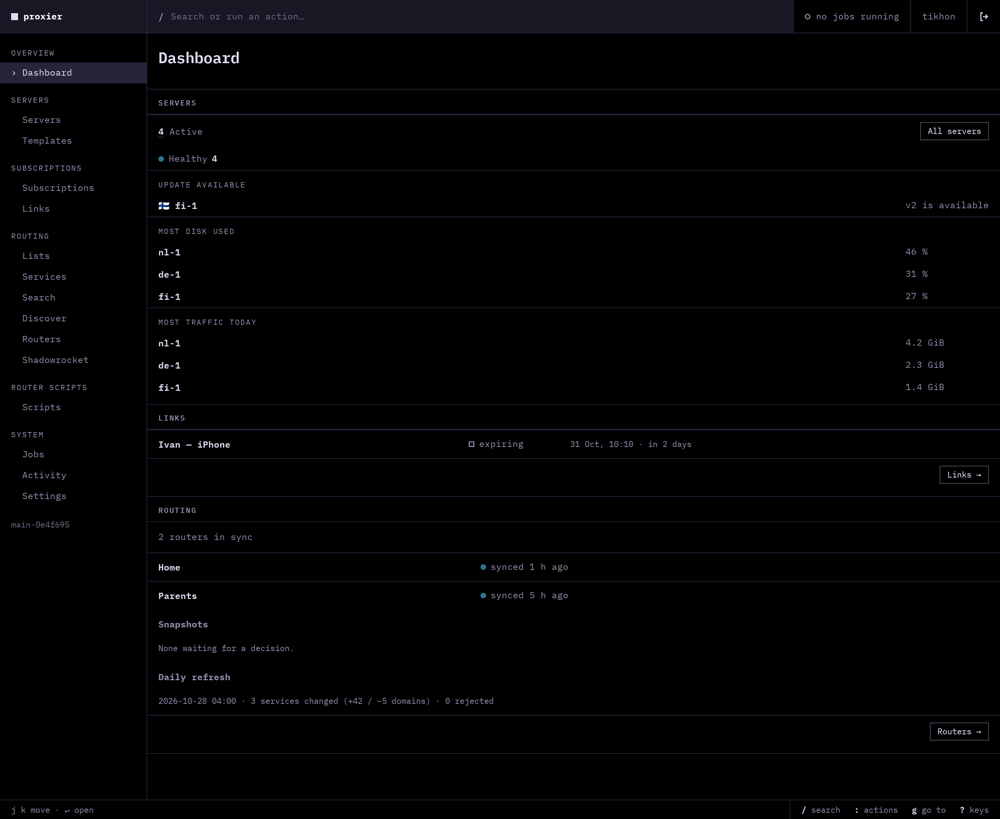
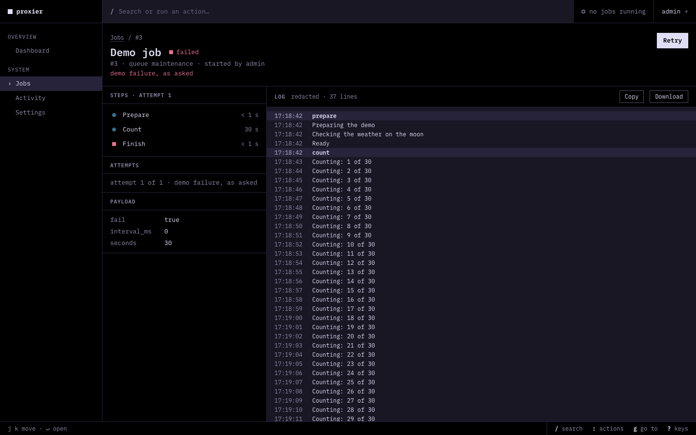
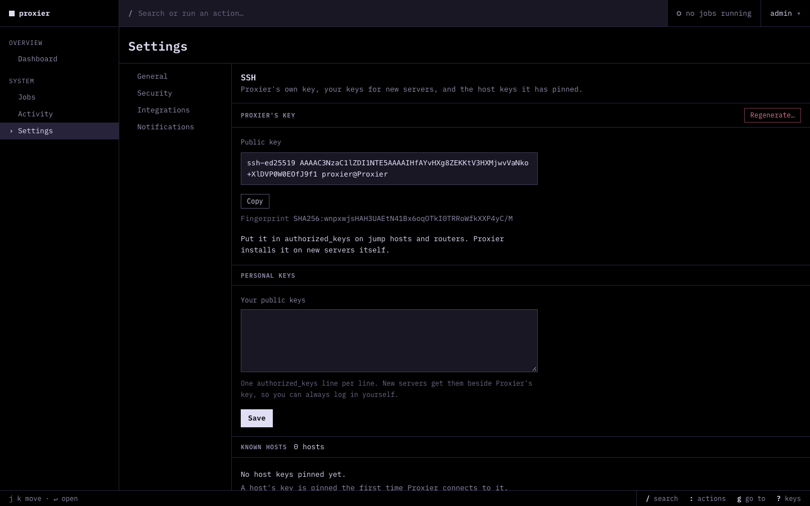

# Proxier

A self-hosted control panel for one person's proxy setup. It builds proxy servers from versioned templates and checks whether they work from Russia, give people and devices subscription links, keep domain routing on MikroTik routers and the Shadowrocket config in sync, and host the router setup script. One Go binary, one SQLite file, a server-rendered web UI (templ + htmx) in English and Russian.



## Status

Every module is built and deployed: the platform (sign-in, settings, the secret vault, jobs with live logs, the event history, Telegram notifications, SSH with pinned host keys, the tailnet node, backups), servers, subscriptions, routing and router scripts. What could still be added is in the [backlog](docs/overview.md#backlog).

## Screenshots

A job page with its steps and live log (a demo job that fails on purpose):



Settings, SSH: Proxier's own key and the host keys it has pinned:



## Documentation

Start at [docs/README.md](docs/README.md): the overview, architecture, decisions (ADRs), data model, per-module docs and process docs.

## Development

```sh
make test     # go test -race (xray's packages without -race)
make check    # templ generate, gofmt, vet, generated-file diff, tests
make dev      # docker compose with hot reload on :8080 (needs .env, see .env.example)
```

## License

AGPL-3.0, see [LICENSE.md](LICENSE.md).
