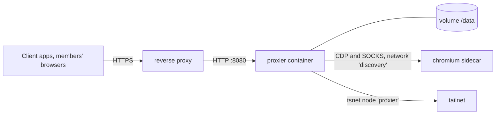

# Deployment

Proxier is one container with one data volume. Put an HTTPS reverse proxy in front of it. Discovery's headless visits need an optional Chromium sidecar, and routers behind other networks need an optional tailnet node. The README has the shortest setup. This document covers a hardened one.

## Where to run it

Run Proxier on a machine inside the network whose blocking it should detect, usually a home server in Russia. Its own proxy tests are the "usable from Russia" verdict ([ADR 0005](./adr/0005-home-is-the-russian-vantage-point.md)). On a VPS abroad, every check passes and Proxier can't tell a blocked server from a working one.

The machine needs Docker, outbound HTTPS and SSH, and a public HTTPS name for the UI and the link URLs (`PROXIER_BASE_URL`). Any reverse proxy that terminates TLS works: nginx, Caddy, Traefik, or a tunnel to a gateway when home has no public IP.

## Topology



## Compose file

```yaml
services:
  proxier:
    image: ghcr.io/tikhonp/proxier:latest
    restart: unless-stopped
    read_only: true
    cap_drop: [ALL]
    security_opt: ["no-new-privileges:true"]
    tmpfs: [/tmp]
    env_file: proxier.env
    environment:
      PROXIER_BASE_URL: https://proxier.example.com
      PROXIER_TRUSTED_PROXIES: 10.89.250.0/29
      PROXIER_CHROMIUM_URL: http://chromium:9222
    volumes:
      - proxier-data:/data
    healthcheck:
      test: ["CMD", "/bin/proxier", "healthcheck"]
      interval: 30s
    networks:
      - proxier
      - discovery

  chromium:
    image: chromedp/headless-shell:157.0.8103.27   # pinned
    restart: unless-stopped
    cap_drop: [ALL]
    security_opt: ["no-new-privileges:true"]
    mem_limit: 1g
    shm_size: 256m
    tmpfs: [/tmp]
    networks:
      - discovery

volumes:
  proxier-data:

networks:
  proxier:
    ipam:
      config:
        - subnet: 10.89.250.0/29
  discovery:
    ipam:
      config:
        - subnet: 10.89.251.0/29
```

`proxier.env` holds the secrets: `PROXIER_MASTER_KEY`, and `PROXIER_TS_AUTHKEY` if you use the tailnet. Put the reverse proxy on the `proxier` network, or publish the port to `127.0.0.1:8080` for a reverse proxy on the host. In both cases its connections come from the `proxier` subnet.

- **`proxier`** runs as uid 65532 on a read-only root file system, with no capabilities and no Docker socket ([ADR 0009](./adr/0009-embedded-xray-core-no-docker-socket.md)). The image is distroless and has no curl, so `proxier healthcheck` asks its own `/healthz`. A fresh named volume is writable; a bind mount must be owned by uid 65532 (`sudo install -d -o 65532 -g 65532 -m 700 ./data ./data/backups`).
- **`chromium`** is optional. Without it, discovery runs the catalog lookup only, and Settings → Integrations and the Discover page say so. See [the Chromium sidecar](#the-chromium-sidecar).

## The reverse proxy

- **Client address.** Send `X-Real-IP`. Proxier believes it only when the TCP peer is in `PROXIER_TRUSTED_PROXIES`. Set that to the address the reverse proxy connects from, here the `proxier` subnet, and keep every other container off that network. If it's unset or wrong, every client looks like the reverse proxy, which breaks the sign-in lockout and the "new IP" notification.
- **Uploads.** Allow request bodies up to 10 MB (template imports).
- **Live logs.** The live job log is a server-sent event stream. Turn off response buffering and allow responses up to an hour (`proxy_buffering off` and `proxy_read_timeout 1h` in nginx).
- **Access log.** Link paths (`/s/`, `/r/`, `/f/`) carry their secret token. Keep those requests out of the reverse proxy's access log. Proxier's own request log masks the token.
- **Security headers.** Proxier sends `Content-Security-Policy`, `Strict-Transport-Security`, `X-Frame-Options`, `Referrer-Policy` and the rest. Add none at the reverse proxy: a browser enforces both `Content-Security-Policy` headers, so a second one would tighten Proxier's.

## The Chromium sidecar

Discovery's headless visits ([domain discovery](./processes/routing/domain-discovery.md)) run in a `chromedp/headless-shell` container. Proxier drives it over the DevTools protocol (CDP).

- **Why its own network.** Any member of the `proxier` network may set `X-Real-IP`. Chromium visits arbitrary sites and runs their scripts, so it lives on `discovery`, which holds only `proxier` and `chromium`. That network isn't `internal`, because a direct visit goes out from Proxier's machine, as a member's own browser would.
- **`PROXIER_CHROMIUM_URL`** is the DevTools address. Proxier resolves its host to an IP before asking `/json/version`, because DevTools refuses a `Host` header that is neither an IP nor `localhost`. It then connects to the WebSocket at that IP.
- **A visit through a server** opens a SOCKS5 listener in Proxier on its address in `discovery`, on a random port, for that visit only. It accepts connections only from the sidecar's IP, because Chrome can't authenticate to a SOCKS proxy, and relays them through the server's endpoint. Each visit gets a fresh browser context (no cookies, no storage), disposed afterwards.
- **Upgrades** are deliberate: change the pinned tag. Nothing else depends on the Chrome version.

## The tailnet

Routers that Proxier can't reach directly sit behind jump hosts on a tailnet. Proxier joins it as its own node through an embedded client ([ADR 0008](./adr/0008-tsnet-node-for-router-reachability.md)). Tailscale and headscale both work.

- `PROXIER_TS_CONTROL_URL`: the control server. The default is Tailscale's, `https://controlplane.tailscale.com`. For headscale, set its URL.
- `PROXIER_TS_AUTHKEY`: a pre-auth key for the first login. Without it the tailnet is off, and routers must be reachable from Proxier's own network.
- The tailnet's ACLs decide which jump hosts and routers the node `proxier` may reach.

## The `/data` volume

```
/data/proxier.db (+ -wal, -shm)   the database
/data/backups/                    nightly snapshots, proxier-YYYY-MM-DD.db, the newest 14
/data/tailnet/                    the tailnet node's state (only once the tailnet is on)
```

The tailnet state is not in the database or its snapshots.

## First start

1. Generate the master key (`openssl rand -base64 32`) and store a copy outside the machine, in a password manager. Without it, nobody can recover the database's secrets.
2. Start the containers. Migrations run on startup. Proxier generates its SSH key pair (ed25519), the default routing list "Main" and the seed template.
3. `docker compose exec proxier /bin/proxier manage create-admin` creates the first member interactively. It's the only way to create one.
4. Sign in. In Settings, add the Cloudflare API token and zones, the Telegram bot (token and detected chat), your personal SSH public keys (installed on every new server), and the check-host nodes. Set the hostname pattern (Settings → Servers) to a name in one of your zones, e.g. `{country}-{number}.hosts.example.com`. It has no default, and until it is set the new-server form refuses every server that has no typed hostname. Then set the time zone and languages.
5. Copy Proxier's public SSH key (Settings → SSH) to the jump hosts and routers you want to sync.

## Backups

- Every night at 03:30 Proxier writes a consistent snapshot of the database (`VACUUM INTO`, on its own connection, so writes continue meanwhile) to `/data/backups/proxier-YYYY-MM-DD.db` and keeps 14. Settings → Backups changes the time and the count. A file appears only when it's complete: Proxier writes it under a temporary name and renames it.
- Copy `/data/backups` off the machine on your own schedule. Copy the snapshots, not the live database, whose copy would not be consistent.
- Settings → Backups → **Back up now** queues a snapshot at once; **Download latest** gives the newest. Its secrets are still encrypted, so restoring needs the same master key.
- To restore, stop the container, put the snapshot in place as `proxier.db`, and start it.

## Images and CI

`.github/workflows/pr.yaml` runs `test` and `lint` on `pull_request_target`. The workflow definition comes from the base branch and checks the PR's exact head commit. It runs on opened, updated and reopened PRs, and when a draft becomes ready for review. New pushes cancel older runs of that PR.

The runner checks out PR files without retaining credentials. It treats those files as data and mounts them read-only into disposable Docker containers. Build, test and lint commands run only inside the containers, on a writable copy of the checkout. Containers receive no GitHub token, repository secrets, runner directories or Docker socket. They drop Linux capabilities, disable privilege escalation and limit CPU, memory and process counts. They can access the internet for dependencies. No PR caches or artifacts are saved or reused by publishing. GitHub-hosted runners are fresh for each job. The test job has a 90-minute limit and lint has a 45-minute limit.

This workflow uses `allow-unsafe-pr-checkout` because checkout v7 otherwise blocks fork source under `pull_request_target`. Keep PR code inside the containers. Do not add host build steps, secrets, writable host mounts, shared caches or self-hosted runners to this workflow.

The workflow must be present on the base branch before it can run automatically. An Actions event policy that blocks `pull_request_target` also blocks these runs. GitHub's default policy is scheduled for enforcement on December 2, 2026. For this repository, the active Actions policy "Allow isolated PR checks" allows the event only for `.github/workflows/pr.yaml`. Configure an equivalent policy when using these workflows in another repository. See [GitHub's guidance](https://docs.github.com/en/actions/reference/security/securely-using-pull_request_target).

`.github/workflows/ci.yaml` validates pushes to `main` and `v*` tags; PRs get their checks from `pr.yaml` instead. Its jobs use Go and lint caches and a read-only token; only the image job can write packages, and only the release job can write releases. Checkouts do not retain credentials. Test has a 90-minute limit. Lint and image publishing each have a 45-minute limit.

- After both `test` and `lint` pass on `main`, the `image` job builds the same Dockerfile's `prod` target for `linux/amd64` and publishes `ghcr.io/tikhonp/proxier:<sha>`, `:main` and `:latest`. The build arguments are `APP_VERSION=main-<sha7>`, the commit timestamp and full commit SHA. PRs do not build or publish images.
- A `v*` tag runs the same `test` and `lint` on the tagged commit, then publishes only `:<tag>` (`APP_VERSION=<tag>-<sha7>`), so `:latest` keeps following `main`. The `release` job then creates a GitHub release for the tag, with notes generated from the merged PRs and the image's name. A tag with a hyphen, such as `v1.2.0-rc.1`, becomes a pre-release. A re-run leaves an existing release unchanged.
- Publishing uses the automatic `GITHUB_TOKEN` with `packages: write` scoped to the image job and `contents: write` scoped to the release job; no registry secret is needed. After the first publish, set the GHCR package's visibility to public if anonymous pulls are wanted. Use `ghcr.io/tikhonp/proxier:latest` in the compose file to pull from GitHub. To control upgrades instead, pin a `:<tag>` and change it on purpose, for example with the Forgejo `deploy` job below.
- Require pull requests and the `test` and `lint` status checks in GitHub's branch protection or ruleset for `main` to enforce merge-only publishing. The workflow runs on pushes to `main`, including direct pushes if repository rules allow them. The workflow runs image publishing jobs for `main` one at a time.

The optional `.forgejo/workflows/ci.yaml` runs the same validation on Forgejo. Image publishing is off until the repository variable `REGISTRY` names your registry, for example `registry.example.com`. Set the secret `REGISTRY_TOKEN` to a token with permission to write packages. Pushes to `main` publish `:<sha>`, `:main` and `:latest`; `v*` tags publish `:<tag>`.

The optional `deploy` job hands the new image to a GitOps repository after the `image` job has pushed it. It runs only on `v*` tags, when both `REGISTRY` and `DEPLOY_REPO` are set, and is otherwise skipped. It clones the branch (depth 1, without submodules) and replaces the one line `<var>=…` in the env file with `<var>=<tag>`. The tag is the tag name, which the `image` job has just published; pushes to `main` deploy nothing. It then commits only that file as `Deploy proxier <tag>` and pushes. If the file has no such line or more than one, the job fails. If the line already holds the tag (a re-run), it commits nothing. When another push gets there first, it rebases and tries again, up to 3 times. Runs for the same repository wait for each other. Any GitOps deployer that watches the env file can then roll the image out. A rollback is a revert of the bump commit in the GitOps repository.

| Setting | Kind | Meaning |
| --- | --- | --- |
| `DEPLOY_REPO` | variable | SSH clone URL of the GitOps repository. Its host must have a public DNS name: jobs may run on a Docker-in-Docker runner that resolves only public names. |
| `DEPLOY_BRANCH` | variable | Branch to commit to; default `main`. |
| `DEPLOY_ENV_FILE` | variable | Path of the env file in that repository; default `.env`. |
| `DEPLOY_ENV_VAR` | variable | Variable that holds the tag; default `PROXIER_V`. |
| `DEPLOY_KNOWN_HOSTS` | variable | `known_hosts` line(s) for the Git host; the host key is checked strictly. |
| `DEPLOY_SSH_KEY` | secret | Private key of a deploy key with write access to the GitOps repository. |

To run your own build, `docker build -t proxier .` and use that image in the compose file.

## Operating notes

- **When Proxier's machine is offline**, the UI and every link URL are unreachable. Client apps keep their last list, so existing connections keep working. The reference check pauses verdicts, so coming back online raises no false alarms.
- **Upgrades** are image updates. Migrations run on startup; a failing migration keeps the old schema and exits. A restart interrupts running jobs, and they resume afterwards ([jobs](./processes/platform/jobs.md)).
- **Losing the master key** loses every secret: generated values, tokens, the Cloudflare and Telegram tokens, Proxier's SSH key. Servers keep running, but Proxier can't manage them, and links would need new tokens.
- **Moving the public host** (a new `PROXIER_BASE_URL`) changes every link URL. Give people the new URLs first, and keep the old name pointing at Proxier until their apps have refreshed from them.
