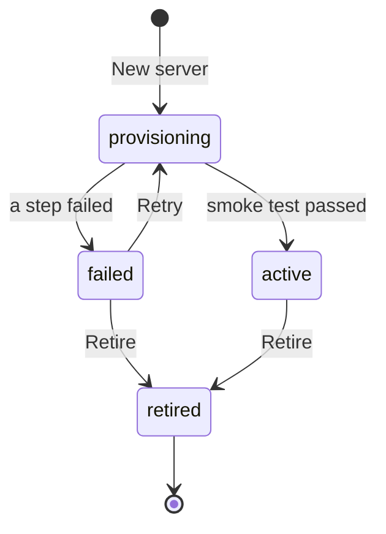

# Servers

The servers module builds a proxy server from a versioned **template**. Afterwards it keeps the server's DNS, stack and secrets, changes the server when asked, and checks whether it works from Russia.

## Countries and names

- A server's **country** is an ISO 3166-1 alpha-2 code (`NL`), chosen when the server is created and never changed. It is all the server stores of where it is: the country's name (English and Russian) and its flag (🇳🇱, the two regional-indicator letters) are derived from the code, never stored ([ADR 0015](../adr/0015-servers-have-a-country-not-a-location.md)). There is nothing to manage: no Locations page, nothing to add, rename or delete. Withdrawn codes (`UK`, `DD`, `SU`…) are not countries.
- A new server gets the **server name** `<code in lower case>-<number>` (`nl-2`), where the number is one more than the highest number its name prefix has ever used. Numbers are **never reused**, not even after a failed provisioning or a retirement: a server is never deleted, so its row keeps its number taken. A name means one server for good. A server created when servers had locations keeps its name and its location's code as its prefix (`ams-1` in NL); new servers of that country count under the country's code.
- The **management hostname** comes from the hostname pattern in Settings → Servers, a name in one of your Cloudflare zones, e.g. `{country}-{number}.hosts.example.com` → `nl-1.hosts.example.com`. `{country}` is the name prefix; `{location}`, its earlier spelling, still works in a saved pattern. The pattern has no default, because each install has its own zone. Until a member sets it, the new-server form refuses every server without a typed hostname, and Settings → Servers and the dashboard's first-run list ask for it.
- A member can type a **hostname** into the new-server form instead, e.g. `vpn.example.com`. It replaces the pattern's name for that server. A name in none of your Cloudflare zones gets a **record made by hand**: the member creates its A record at their DNS provider, and Proxier checks it before creating the server unless the member selects Skip DNS check. See [DNS](#dns). The server name stays `<code>-<number>`. No two non-retired servers have the same hostname, typed or from the pattern.
- The **proxy hostname** is the name in connection URIs and the TLS certificate. It is always the management hostname. The two are separate fields, so proxy hostnames on other domains would need no data migration ([DNS](#dns)).
- When a member pastes an IP into the new-server form, Proxier looks up the IP's country and preselects it in the country picker. It is only a suggestion.

## Addresses

- A server has one **primary address**: its IP, management hostname and proxy hostname, the one SSH, DNS and the IP change use. It may also have **additional addresses**: more IPs on the same machine, each with its own hostname.
- Additional addresses are added in the new-server form or later on an active server's **Addresses** page. A server still has one stack, and its template gives each address its own inbound or server block and endpoint. Adding or removing one redeploys the server.
- **Proxier does not manage their DNS.** It writes no record, checks none and never deletes one: the member points each additional hostname at its IP. The primary address keeps the behaviour in [DNS](#dns).
- Positions are stable: address 1 is the primary one, then 2, 3… in the order they were added. An endpoint binds to one by position (`address: 2`). Only the last additional address can be removed, so positions never shift under a published template; removing it and adding another reuses the number.
- Health checks, check-host.net and IP change remain about the **primary** address. The proxy test from home still runs through every endpoint, including those on additional addresses ([health](#health-and-stats)).

## Access and setup

Each server stores its access mode, SSH account and setup mode at creation. Later jobs use the same account and Proxier's key. These choices cannot change after creation. Retire the server and create a new one to change them.

With root password access, the provisioning job creates the `proxier` account, installs Proxier's key and gives the account passwordless sudo. It erases the root password once key login and sudo work. See [ADR 0012](../adr/0012-secrets-encrypted-root-password-never-stored.md).

With SSH key access, install Proxier's public key in the account's `authorized_keys` before creating the server. Copy the key from Settings → SSH. The account defaults to `root`. Any other account needs passwordless sudo. Proxier does not create an account or install keys in this mode.

Full setup disables password and root login over SSH, resets the firewall, enables TCP BBR when the kernel supports it, and installs the prerequisites and Docker. Deploy only installs the prerequisites and Docker if missing. It leaves SSH configuration, firewall rules and TCP settings unchanged. Key access as `root` requires Deploy only because full setup would disable its next login.

Settings → Servers has defaults for new servers. Access defaults to Root password and setup defaults to Full. Changing these defaults does not affect existing servers. See [provisioning](../processes/servers/server-provisioning.md).

## Templates

A **template** is a named definition of a server's stack. Templates are stored in Proxier, edited in the UI, versioned, and validated when published ([ADR 0003](../adr/0003-proxier-rendered-stack-templates.md)). Proxier generates the secrets, renders every file and runs every step itself. It always knows the server's real configuration, so it can redeploy, upgrade and rotate later.

A **template version** is a **manifest** (`manifest.yaml`) plus files. Versions are immutable and numbered 1, 2, 3… Editing happens in a **draft** based on the latest version, and publishing the draft creates the next version. Each template has a **default version** used for new servers. A newer version never touches existing servers by itself: they show "update available" until a member upgrades them.

Lifecycle and validation: [template authoring](../processes/servers/template-authoring.md).

### Manifest

The [seed template](../integrations/vless-xhttp.md) shows the manifest's fields. Preflight checks the server against `requires.os` and `requires.arch`. In `requires.os`, `ubuntu-22.04+` accepts Ubuntu 22.04 and later Ubuntu releases. An entry without `+` accepts only the listed release.

```yaml
name: VLESS XHTTP behind nginx
description: VLESS over XHTTP, hidden behind nginx with a Let's Encrypt certificate and a decoy site.

requires:
  os: [debian-12+, ubuntu-22.04+]
  arch: [amd64, arm64]
dir: /opt/proxier/vless-xhttp        # where the stack lives on the server
ports: [80/tcp, 443/tcp]             # opened in the firewall, besides SSH

parameters:                          # asked when building a server
  - key: letsencrypt_email
    label: Let's Encrypt email
    type: email
    required: false
    sample: admin@example.com        # used by validation

generated:                           # created once per server, reused on every redeploy
  - { key: client_uuid, kind: uuid, rotate: true }
  - { key: xhttp_path, kind: hex, length: 16, prefix: /, rotate: true }
  - { key: container_postfix, kind: hex, length: 4 }

files:                               # rendered with Go templates, uploaded into dir
  - { path: compose.yaml, validate: compose }
  - { path: xray-config.json, validate: xray }
  - { path: nginx/default.conf.template, validate: nginx }
  - { path: site/index.html }
  - { path: .env, mode: "0600" }
  - { path: issue-cert.sh, mode: "0755", validate: shell }

steps:
  install:                           # provisioning
    - base-bootstrap
    - upload-files
    - run: ./issue-cert.sh
      timeout: 5m
    - compose-up: { pull: true }
    - wait-http: { url: "https://{{ .Server.ProxyHostname }}/", resolve: 127.0.0.1, status: 200 }
  redeploy:                          # redeploy, upgrade, rotation
    - upload-files
    - compose-up
  uninstall:                         # retirement with "remove the stack"
    - compose-down: { volumes: true }

endpoints:                           # what clients connect to
  - key: main                        # stable across versions; subscriptions rely on it
    type: vless-xhttp-tls
    host: "{{ .Server.ProxyHostname }}"
    port: 443
    credential: "{{ .Gen.client_uuid }}"
    params:
      path: "{{ .Gen.xhttp_path }}"
      sni: "{{ .Server.ProxyHostname }}"
      mode: stream-up
      fp: chrome
      alpn: h2

checks:                              # the self-check
  - compose-running
  - http-local: { url: "https://{{ .Server.ProxyHostname }}/", status: 200 }
  - cert-expiry: { file: "certbot/conf/live/{{ .Server.ProxyHostname }}/fullchain.pem" }
  - disk-free

proxy_test:                          # optional; overrides Settings → Servers → proxy test URL
  url: "https://speed.cloudflare.com/__down?bytes=262144"
```

**Parameters** have a `key`, `label`, `type` (`string`, `email`, `int`, `bool`, `choice` with `options`, `text`), optional `required`, `default`, `sample`, `help`, and `secret` (stored encrypted, masked in the UI).

**Generated values** have a `key` and a `kind`: `uuid` (v4), `hex` (`length` characters), `base64` (`bytes`), or `password` (`length`, letters and digits). Each can have a `prefix`. `rotate: true` marks the values that rotation replaces. They are created on first use for a server and kept for the server's life. Upgrading to a version that declares a new one creates it. A value no longer declared is kept, unused, so a rollback still works.

**Files** have a `path`, an optional `mode` (default `0644`) and an optional `validate` (`xray`, `compose`, `nginx`, `json`, `yaml`, `shell`). A path is relative and `/`-separated, with no `..`, no leading `/` and no `./`, at most 255 bytes, and only `A-Z a-z 0-9 . _ - /` (paths end up in shell commands and SFTP paths). A file in the template that `files` does not list is an error, except `manifest.yaml`. A file is at most 1 MiB, and a version at most 10 MiB, counted on the files as written (before rendering).

**Steps** are lists for `install`, `redeploy` and `uninstall`. `install` must start with `base-bootstrap`, then `upload-files`, and `redeploy` must start with `upload-files`; neither kind may appear anywhere else, nor in `uninstall`. The provisioning and deploy jobs run those as steps of their own (with DNS and the generated values in between during provisioning), so their place is fixed. A `run` step whose command starts with `./` must name a file listed in `files` (`./issue-cert.sh` needs `issue-cert.sh`). Built-in step kinds:

| Step | What it does |
|---|---|
| `base-bootstrap` | Uses the server's stored SSH account. Root commands use `sudo -n` unless that account is root. Both setup modes install `curl ca-certificates openssl ufw` and Docker if missing, and wait for apt's lock. Full setup also disables password and root login over SSH, writes `.hushlogin`, enables TCP BBR when supported, and resets and enables ufw with only the SSH port and manifest `ports` allowed. It verifies SSH changes with a new key login and rolls them back if verification fails. Deploy only leaves SSH configuration, firewall rules and TCP settings unchanged. Docker's published ports bypass ufw. |
| `upload-files` | Renders every file and uploads each one to a temporary name before renaming it into place, so no file is half-written. Deletes files that an earlier deployment of this server put there and this version no longer has. Never touches anything else in `dir` (runtime data such as `certbot/`). |
| `run` | Runs a command or a bundled script in `dir`, with a timeout (default 10 min). Exit code 0 is success. Output goes to the job log. |
| `compose-up` | `docker compose up -d --remove-orphans`, with `pull: true` pulling images first. |
| `compose-down` | `docker compose down`, with `volumes: true` adding `-v`. |
| `wait-http` | Polls a URL until it answers with the expected status (default timeout 2 min). With `resolve`, the request runs on the server through `curl --resolve`. |

**Endpoints** declare what clients connect to: a stable `key`, an endpoint `type`, `host`, `port`, `credential` and type-specific `params`. They are rendered on every deployment and stored, so subscriptions always serve current values. An endpoint may set **`address: <n>`** to bind to one of the server's addresses (1 is the primary); its `host` defaults to that address's hostname, and fields see `.Address`. If the server has no such address, the endpoint is left out, so a template can declare endpoints for every address it can use.

**Checks** are the self-check, run over SSH every 5 minutes:

| Check | Passes when |
|---|---|
| `compose-running` | Every compose service is running, and healthy if it declares a healthcheck. |
| `http-local` | The URL, requested on the server itself (`curl --resolve`), returns the status. |
| `cert-expiry` | The certificate exists. Fewer than 14 days left raises `server.cert_expiring` but doesn't fail the check. An expired certificate fails it. |
| `disk-free` | More than 10 % of the root filesystem is free (below that, `server.disk_low`). Under 2 % fails the check. |
| `run` | A custom command exits 0. |

### Rendering

Files, step arguments, endpoint fields and check arguments are Go templates. Missing keys are errors. The context is:

| Name | Example |
|---|---|
| `.Server.Name`, `.Server.Number` | `nl-1`, `1` |
| `.Server.Country.Code`, `.Name`, `.Flag` | `NL`, `Netherlands`, `🇳🇱` (the English name) |
| `.Server.Location.Code`, `.Name`, `.Country` | `nl`, `Netherlands`, `NL`: what templates saw before servers had a country, kept so they still render; `Code` is the first half of the server name |
| `.Server.IP`, `.Server.SSHPort` | `203.0.113.10`, `22` |
| `.Server.SSHIP` | effective SSH connection IP, e.g. `100.64.0.10` on Tailscale; falls back to `.Server.IP`. Never use this for public endpoints or nginx service bindings. |
| `.Server.ManagementHostname`, `.Server.ProxyHostname` | `nl-1.hosts.example.com` |
| `.Addresses` | the server's addresses, primary first: a list of `{IP, Hostname, Number, Primary}`. Loop it to give each one a server block or inbound. |
| `.Address` | inside an endpoint with `address:`: that address's `{IP, Hostname, Number, Primary}`; nil in files |
| `.Params.<key>` | parameters |
| `.Gen.<key>` | generated values |
| `.Clients` | the client identities the stack must accept: a list of `{ID, Name}`. It holds one entry per distinct endpoint credential: the first is named `shared`, the others `shared-<endpoint key>`. A template with one credential sees one entry. |
| `.Template.Slug`, `.Template.Version` | `vless-xhttp`, `3` |

Functions: `json`, `quote`, `default`, `lower`, `upper`, `trim`, `urlquery`, `b64enc`, `sha256`, `join`, `indent`.

### The client list

Proxier shares one credential per endpoint ([ADR 0004](../adr/0004-one-shared-credential-per-endpoint.md)). Templates still render xray's client list from `.Clients` rather than from `.Gen.client_uuid` directly:

```json
"clients": [{{ range $i, $c := .Clients }}{{ if $i }},{{ end }}{ "id": {{ json $c.ID }}, "email": {{ json $c.Name }} }{{ end }}]
```

Per-link or per-subscription credentials would then only mean filling `.Clients` with more entries and redeploying; templates written this way keep working.

### Import and export

- **Export** a version as a zip: `manifest.yaml` and its files, with the same layout as the editor.
- **Import** a zip, or supply a git URL, path and ref. For example, use `https://github.com/example/proxy-templates`, `proxy/` and `main`. Proxier creates a draft and validates it like any other edit. Keep templates in a separate repository for backup and review.
- The **seed template** "VLESS XHTTP behind nginx" is created on first start, once (deleting it later does not bring it back). Its images stay `:latest`, so it is published with the two warnings that causes; **Update images** pulls new versions.

## Lifecycle



- **provisioning**: the provisioning job is queued or running ([provisioning](../processes/servers/server-provisioning.md)).
- **active**: built and verified. Health checks run, and the server can be added to subscriptions.
- **failed**: provisioning stopped at a step. The server page shows the step, the error and the log, with **Retry** and **Retire**.
- **retired**: out of service for good, kept for history ([retirement](../processes/servers/server-retirement.md)). It can't be brought back; build a new server instead.

Only **active** servers have a health state ([health](../processes/servers/server-health.md)): healthy, degraded, blocked, down, unknown or paused.

## Server page

- **Overview**: flag and name, health badge with "since" and a one-sentence reason, lifecycle state, IP and previous IPs, hostnames, additional addresses, country, template and version (with "update available"), endpoints with their connection URIs (copy, QR, reveal), the subscriptions it is in, notes, and recent events.
- **Health**: the latest result of each check per vantage point, as a matrix with 24 h strips, plus the verdict explanation and a timeline of health states (24 h / 7 d / 30 d), **Run checks now** and **Pause checks** / **Resume** ([health](../processes/servers/server-health.md)). Below the matrix, when there are any, the previous IPs with their state, latest result and strip, and **Switch back** and **Forget** ([IP change](../processes/servers/ip-change.md#steps-previous-ips)).
- **Stats**: CPU, memory, disk and traffic charts for 24 h / 7 d / 30 d, and container states ([stats](../processes/servers/server-stats.md)).
- **Stack**: the rendered files of the last deployment (secrets masked until revealed), its template version, and the deployment history with diffs.
- **Jobs** and **Activity**: filtered to this server.

Actions:

| Action | Allowed when | What happens |
|---|---|---|
| Retry | failed | Resumes provisioning from the failed step. Asks for the root password again if password access failed before Proxier's key was installed; a key-access server never asks. |
| Activate anyway | failed, only the smoke test failed | Makes the server active without a passing proxy test, after a confirmation. Health then comes from the checks, usually `blocked` ([provisioning](../processes/servers/server-provisioning.md#steps-after-a-failure)). |
| Redeploy | active | Re-renders the current version. Shows the diff, then applies it ([redeploy](../processes/servers/server-redeploy.md)). |
| Upgrade | active, newer version exists | Renders the chosen version. Asks for any new parameters, shows the diff, then applies it. |
| Edit parameters | active | Changes parameters, then redeploys. |
| Rotate credentials | active | Replaces the rotatable generated values and redeploys ([rotation](../processes/servers/credential-rotation.md)). |
| Addresses | active | Adds or removes an additional IP and hostname, then redeploys. Proxier does not write their DNS records ([addresses](#addresses)). |
| Change IP | active | Moves the server to another IP of its VPS. SSH there must show its host key and the proxy test from home must pass before Proxier repoints DNS. The old IP can stay as a previous IP, tested from home ([IP change](../processes/servers/ip-change.md)). |
| Restart stack | active | `docker compose restart`, then a self-check. |
| Update images | active | `docker compose pull` + `up -d`, then a self-check and proxy test. |
| Container logs | active, or failed with an uploaded stack | Shows the last 200 lines of each compose service (a read-only job; the output is its log). |
| Roll back | active, latest deployment failed after uploading files | Opens the plan for the version and parameters of the current files, forced ([redeploy](../processes/servers/server-redeploy.md)). |
| Reboot | active | Reboots, waits for SSH, then runs a check round. |
| Run checks now | active | Runs a full check round right away. |
| Pause checks / Resume | active | Health becomes `paused` for 1 h, 6 h, 24 h or until resumed. No notifications meanwhile; the end of a timed pause is a delayed job that checks the stored time. Resume goes to `unknown` and starts a round. |
| Edit notes | any | — |
| Retire | provisioning, failed, active | Type the server name to confirm ([retirement](../processes/servers/server-retirement.md)). |

There is no rename and no country change: the name is the identity. The IP can change, within the same VPS ([IP change](../processes/servers/ip-change.md)); moving to another VPS is on the [backlog](../overview.md#backlog).

## Server list

Columns: name with flag, health badge and since when, lifecycle state (when not active), IP, proxy hostname, template version (with "update available"), last proxy test latency, CPU / memory / disk mini-bars, traffic today, number of subscriptions. Filters: lifecycle state (default: everything but retired), health state, country (the countries that have servers, by name), template. Bulk actions: **Run checks now**, **Upgrade to default version** (rolling, see [redeploy](../processes/servers/server-redeploy.md)), **Pause checks**.

## Endpoints and connection URIs

The one endpoint type is `vless-xhttp-tls`. Given an endpoint, it builds the connection URI exactly as `setup.sh` printed it ([VLESS XHTTP integration](../integrations/vless-xhttp.md)), and it runs the proxy test.

The **display name** of an endpoint (the `#fragment` apps show) is `{flag} {country name} {number}`, e.g. `🇳🇱 Netherlands 1`. A server with several endpoints adds the endpoint key: `🇳🇱 Netherlands 1 · main`. The country name is the English one, in every link whatever its language (a link's language changes only its stub entries). Display names are stored with the endpoints, refreshed by every deployment. The `EndpointCatalog` port also carries each server's flag, derived from its country, and `endpoint.MaskedURI` gives a URI with the credential and the secret path shown as `••••••••` (previews).

## DNS

DNS is a driver; Cloudflare is the one there is ([Cloudflare integration](../integrations/cloudflare.md)).

- Provisioning creates an **A record** for the management hostname (and for the proxy hostname, once they differ) pointing to the server's primary IP. It is **DNS-only, never proxied**: clients and Let's Encrypt must reach the server directly. TTL is 60 s, and the record carries the comment `proxier:<server name>`.
- Proxier only ever changes or deletes records that carry its comment. A different record already at that name stops provisioning with a conflict, unless a member confirms an overwrite.
- After writing, Proxier waits until the zone's own nameservers serve the record, then until 1.1.1.1 and 8.8.8.8 both return the IP (timeout 10 min, longer while a resolver may still hold a "no such name" from before the record existed), before anything needs the name, for example the certificate. It asks the resolvers over DNS-over-HTTPS, and over plain UDP port 53 only when DoH cannot be reached, because the home router may intercept port 53. The nameservers only speak port 53; when they can't be asked, the wait pauses 10 s instead ([Cloudflare](../integrations/cloudflare.md#behaviour)).
- An IP change brings the records to the new IP, after SSH and the proxy test have passed there ([IP change](../processes/servers/ip-change.md)).
- Retirement deletes the records, if they still point to the server's primary IP.
- Proxier never writes, checks or deletes the records of **additional addresses**. Point each additional hostname at its IP before the endpoints there are tested ([addresses](#addresses)).
- The member manages a record made by hand, marked by `manual_dns` on the server. Proxier never writes, changes or deletes it. By default, Create and Check the record require it to resolve only to the server's IP. Provisioning also waits for DNS. Skip DNS check skips both checks and the wait for that provisioning job, including retries. It does not skip certificate issuance, self-checks or the smoke test. IP changes still require the record to resolve only to the new IP. Retirement leaves the record and asks the member to delete it. See [provisioning](../processes/servers/server-provisioning.md).
- **Accepted risk:** each server's certificate names its hostname, and every certificate is published in certificate-transparency logs. Anyone, including a censor, can list `*.hosts.example.com` on crt.sh. The fix in the [backlog](../overview.md#backlog) is wildcard certificates issued centrally through Cloudflare DNS-01 and uploaded to servers, optionally with proxy hostnames on unlinked cover domains. Management and proxy hostnames are separate fields, so it needs no data migration.

## Health and stats

Summarised here, defined in the process docs:

- **Checks**: the self-check over SSH (5 min), the proxy test from home through every endpoint (5 min), check-host.net TCP checks from Russia and abroad (30 min and on demand), and the reference check of home's own internet access.
- **Previous IPs**: the proxy test from home aimed at each previous IP (30 min), so a member hears when one works again ([IP change](../processes/servers/ip-change.md#steps-previous-ips)).
- **Verdict** rules and flap protection: [health](../processes/servers/server-health.md). Subscriptions can hide unhealthy servers (per subscription).
- **Stats**: collected in the same SSH session as the self-check ([stats](../processes/servers/server-stats.md)).

## Ports for other modules

| Port | Used by | Contract |
|---|---|---|
| `EndpointCatalog` | subscriptions | Active servers with their endpoints (display name, type, host, port, credential, params), health state and "since". Changes arrive as events (`server.activated`, `server.redeployed`, `server.credentials_rotated`, `server.health_changed`, `server.retired`). |
| `Rotator` | subscriptions (cut-off) | `RotationRequest(serverID, actor)`: the `servers.rotate` job (resource key `server:<id>`) for the caller to enqueue in its own transaction; nothing is enqueued. `ErrNotActive` for a server that isn't active, is retiring or is gone; `ErrNothingToRotate` when its version marks no generated value `rotate: true`. Every way the job ends records `server.credentials_rotated` or `server.redeploy_failed{kind: rotate}` with actor `job:<id>`. |
| `ServerHostnames` | routing | `Servers(ctx)`: every server whose state isn't `retired` (a retiring one included: its DNS still points at it), by id, with its name, IP and management, proxy and additional-address hostnames (no empty or duplicate ones; a name that leads to the server through any address must not be routed through it). Routing refuses to route the hostnames and names the server; services hold no IPs, so it doesn't use them. |
| `ProxyDialer` | routing (discovery) | A dial function (`servers.DialFunc`) and its closer that send traffic through a chosen active server's endpoint (an in-process xray client). Discovery's SOCKS listener relays through it. |

It consumes one port from routing: `RoutingGuard` (`Covering(ctx, hostnames)`, set by `SetRouting`), which the new-server form asks before creating anything; a hostname a routing list covers is a form error naming the list and the service. Without the routing module it is nil and nothing is checked.

## Events

`template.*`, `server.*`, `health.*`: see [events](../events.md#servers). Old `location.*` events still show in Activity; nothing records them any more.
