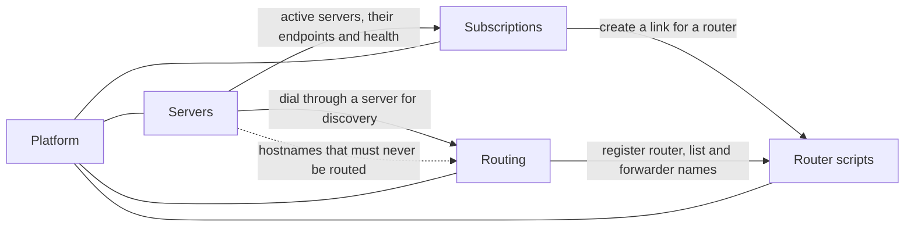

# Overview

## What it replaced

Before Proxier, every part of the proxy setup was manual and lived in a different place:

| Before | Problem |
|---|---|
| A fresh VPS got `servers-templates/proxy/setup.sh` piped into bash. It asked for the domain, email and link name, and printed a `vless://` link into `credentials.txt`. DNS records were made by hand. | Every server was a manual session. Nothing remembered which servers existed, how they were built, or their secrets. Changing a server meant SSH and editing by hand. |
| Connection links were copied out of `credentials.txt` and sent to people one by one. | No list of who had access to what. A new server meant re-sending links; taking access away meant rebuilding the server. |
| Nothing watched the servers. | A blocked or dead server showed up as a complaint. |
| `mtvpn.py` (a CLI) filled the MikroTik address list from v2fly, iplist and URL sources over SSH, rendered the Shadowrocket config and uploaded it to copyparty. The service lists were text files on copyparty. | It ran only when run. Upstream changes reached routers only after a manual `update`. Finding a new site's domains was guesswork. |
| `fresh-router.rsc` was edited by hand for every new router. | Its current version and parameters lived in memory and git history. |

Proxier does all of this as one always-on service: a web UI for its members, background jobs for long work, and public URLs for client apps, routers and phones.

## Who uses it

- **Members** sign in, each on their own, with a level of access in each area ([members](./processes/platform/members.md), [ADR 0018](./adr/0018-several-members-with-per-area-access.md)); the first one has the Owner preset and adds the others. Everything happens in the web UI, on a desktop or a phone, with Telegram notifications.
- **Link holders** (family, friends, members' own devices) never sign in. They see only what their app gets from their link: connection URIs, a title and an expiry date.
- **Routers** are MikroTiks that Proxier reaches over SSH, directly or through a jump host on the tailnet, to keep their domain lists in sync. A new router downloads its filled-in setup script from a fetch URL.
- **Shadowrocket** on the phone subscribes to a hosted config URL.

## Modules

Proxier is one service made of separate modules. Each can be changed or left out without rewriting the others ([ADR 0002](./adr/0002-modules-talk-through-ports-and-events.md)).

| Module | Purpose | Flows |
|---|---|---|
| **Platform** | Sign-in, settings, secrets, jobs and the scheduler, events and history, Telegram notifications, SSH, the tailnet, two languages, backups. | [sign-in](./processes/platform/sign-in.md), [members](./processes/platform/members.md), [jobs](./processes/platform/jobs.md), [notifications](./processes/platform/notifications.md) |
| **Servers** | Turns an IP and a root password into a working proxy server from a versioned template. Keeps its DNS, stack and secrets. Checks from home and from abroad whether it works or is blocked. Shows its resources. | [template authoring](./processes/servers/template-authoring.md), [provisioning](./processes/servers/server-provisioning.md), [redeploy](./processes/servers/server-redeploy.md), [rotation](./processes/servers/credential-rotation.md), [health](./processes/servers/server-health.md), [stats](./processes/servers/server-stats.md), [retirement](./processes/servers/server-retirement.md) |
| **Subscriptions** | Groups servers into subscriptions and gives each person or device a link to one of them. Serves the connection URIs at that link, with expiry and shared-link alerts. | [subscription management](./processes/subscriptions/subscription-management.md), [link lifecycle](./processes/subscriptions/link-lifecycle.md), [fetch](./processes/subscriptions/subscription-fetch.md), [shared-link alerts](./processes/subscriptions/shared-link-alerts.md) |
| **Routing** | What mtvpn did, always on: services from v2fly, iplist, URLs and custom lists; search; discovery of a site's domains; routing lists; router sync with drift repair; the hosted Shadowrocket config. | [catalog search](./processes/routing/catalog-search.md), [services](./processes/routing/service-management.md), [discovery](./processes/routing/domain-discovery.md), [upstream refresh](./processes/routing/upstream-refresh.md), [routing lists](./processes/routing/routing-lists.md), [router sync](./processes/routing/router-sync.md), [Shadowrocket](./processes/routing/shadowrocket-config.md), [mtvpn import](./processes/routing/mtvpn-import.md) |
| **Router scripts** | Keeps `fresh-router.rsc` in versions and fills in its parameters for a new router. Can create the router's subscription link and register it for sync in the same step. Serves the result at a one-time fetch URL. | [versions](./processes/router-scripts/script-versions.md), [generation](./processes/router-scripts/script-generation.md) |

How they connect:

## What it does

1. A fresh VPS becomes an active, verified proxy server from the UI, with nothing typed over SSH and nothing done in DNS by hand.
2. Templates are versioned, edited in the UI, validated when published, and checked by a smoke test after every provisioning.
3. Every server is checked all the time: on the server, through a real proxy connection from home, and from check-host.net nodes inside and outside Russia. A change of verdict reaches Telegram.
4. Every person or device has its own named link. Links belong to a subscription, can expire, and raise an alert when they look shared.
5. Routers and the Shadowrocket config follow routing lists on their own, with safety checks on upstream changes. mtvpn and the copyparty uploads are retired.
6. Typing a site's address finds its domains.
7. A new router is set up from a filled-in, versioned `fresh-router.rsc` that it fetches itself.
8. The UI speaks English and Russian.
9. Several members share one Proxier, each with a level in each area, their own things and their own Telegram notifications.

## Out of scope

- Roles beyond a level per area, or anything multi-tenant: one site, whose servers every member shares ([ADR 0018](./adr/0018-several-members-with-per-area-access.md)). Selling access, payments, traffic accounting.
- Per-link credentials on servers. Credentials are shared per endpoint ([ADR 0004](./adr/0004-one-shared-credential-per-endpoint.md)).
- Ordering, paying for or cancelling VPSes through provider APIs.
- Managing a router beyond its tunneled-domain list (DHCP, VLANs, firewall).

## Backlog

Not built, roughly in order of value. Each needs an extension point or a new flow; nothing built so far stands in the way.

- More formats: mihomo/Clash YAML (also for the router's mihomo container), sing-box JSON, a browser page with QR codes and app buttons.
- Replacing a blocked server while keeping its name and credentials, with DNS repointed.
- Adopting servers built without Proxier.
- Probe agents on mobile networks and other ISPs.
- A VLESS Reality endpoint type and template, as a fallback when a domain gets blocked.
- Wildcard certificates issued centrally through Cloudflare DNS-01, optionally with proxy hostnames on cover domains, so server names stay out of certificate-transparency logs ([servers module](./modules/servers.md#dns)).
- VPS billing and renewal reminders.
- IP ranges in services (Telegram, voice calls). Routing targets: a plain list URL, a mihomo rule-provider, a sing-box rule-set.
- Discovery by HAR import and subdomain search.
- Telegram bot commands (status, pause checks, create a link). The bot only sends.
- More notification channels: ntfy, email, webhook.

## Assumptions

- The blocking Proxier must detect is Russian. Home, where Proxier runs, is in Russia, so Proxier is itself a Russian vantage point ([ADR 0005](./adr/0005-home-is-the-russian-vantage-point.md)).
- Proxier runs on the home server (blackberry) behind the sh-main gateway. The UI and the public URLs share one public host with password sign-in ([ADR 0006](./adr/0006-one-public-host-for-admin-and-public-urls.md)).
- DNS is Cloudflare. Notifications go to Telegram. Servers run Debian or Ubuntu with Docker.
- Go and SQLite in one binary ([ADR 0001](./adr/0001-single-binary-sqlite-in-process-jobs.md)), images built by Forgejo Actions on code.tikhonnnnn.com, a server-rendered UI with templ and htmx ([ADR 0014](./adr/0014-server-rendered-ui-templ-htmx.md)).
